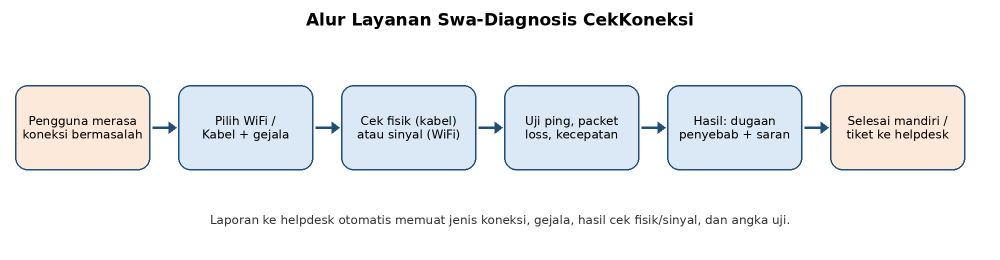
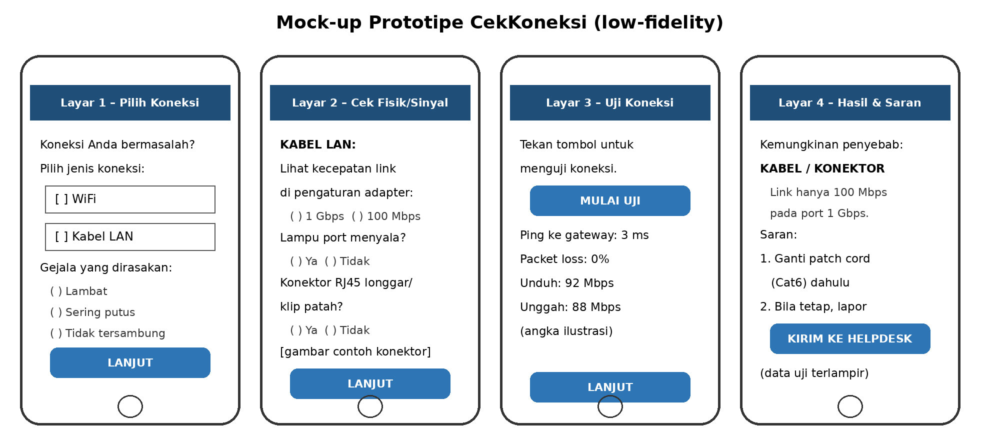

# CekKoneksi

Prototipe alur swa-diagnosis untuk membantu karyawan non-TI mengetahui apakah gangguan koneksi berasal dari **WiFi** atau dari **kualitas kabel LAN**, sebelum menghubungi helpdesk.

**Coba prototipe:** https://trypurwanto19.github.io/cekkoneksi/

> Prototipe ini dibuat untuk keperluan uji pengguna (mata kuliah Design Thinking untuk Keberlanjutan, Magister Manajemen Universitas Mercu Buana). Hasil uji koneksi di dalamnya adalah **simulasi** berdasarkan jawaban pengguna, bukan pengukuran jaringan sebenarnya, dan laporan ke helpdesk tidak benar-benar dikirim.

## Latar belakang

Keluhan "internet lambat" sering sampai ke helpdesk tanpa keterangan apakah pengguna memakai WiFi atau kabel. Pada jaringan kabel, patch cord yang tertekuk, klip konektor RJ45 yang patah, atau kabel kategori lama dapat menurunkan kecepatan link dari 1 Gbps menjadi 100 Mbps atau memicu paket hilang. Pada WiFi, gangguan lebih sering berasal dari sinyal lemah atau access point yang padat. CekKoneksi membantu membedakan keduanya, sehingga penggantian kabel atau perangkat lebih tepat sasaran dan limbah elektronik berkurang.

## Alur



1. **Pilih koneksi dan gejala** – WiFi atau kabel LAN; lambat, putus-sambung, atau tidak tersambung.
2. **Cek fisik atau sinyal** – kabel: kecepatan link adapter, lampu port, kondisi konektor; WiFi: bar sinyal, posisi terhadap access point, waktu gangguan.
3. **Uji koneksi** – ping, paket hilang, kecepatan unduh dan unggah (simulasi).
4. **Hasil dan saran** – dugaan penyebab beserta langkah yang dapat dilakukan sendiri.
5. **Kirim laporan** – ringkasan data pemeriksaan untuk helpdesk.

## Mock-up awal



## Logika diagnosis

| Indikator | Dugaan penyebab | Saran |
|---|---|---|
| Kabel: link 100/10 Mbps pada port 1 Gbps | Kawat putus, konektor buruk, atau kabel Cat5 lama | Ganti patch cord Cat6, uji ulang |
| Kabel: lampu port mati | Kabel lepas atau putus | Pasang ulang, coba port lain |
| Kabel: konektor longgar/klip patah | Konektor rusak | Ganti patch cord |
| Kabel: link normal tetapi putus-sambung | Kabel terjepit atau tertekuk | Periksa jalur kabel |
| WiFi: sinyal 1–2 bar | Jarak jauh atau penghalang | Mendekat ke access point atau pakai kabel |
| WiFi: sinyal kuat, lambat saat jam sibuk | Access point padat | Laporkan ke helpdesk |

## Struktur repositori

```
index.html     halaman prototipe (HTML, CSS, JavaScript dalam satu berkas)
docs/          gambar mock-up dan alur layanan
.nojekyll      agar GitHub Pages menyajikan berkas apa adanya
```

## Menjalankan secara lokal

Cukup buka `index.html` di peramban. Tidak ada dependensi atau proses build.

## Penulis

Tri Purwanto – Magister Manajemen, Universitas Mercu Buana
